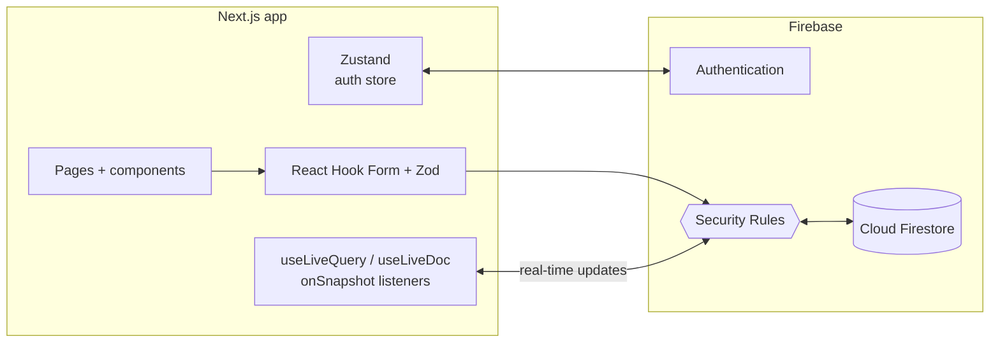

# CareSync

[](https://github.com/keerthanan2211/caresync/actions/workflows/ci.yml) [](LICENSE)

A clinic care-coordination dashboard for doctors and nurses. Keep patient records, log vital signs that are automatically flagged when out of range, track trends, book appointments without double-booking, and discuss each patient in a real-time care-team chat.

**Stack:** Next.js 14 · TypeScript · Tailwind CSS · Firebase Authentication · Cloud Firestore (real-time) · Firestore Security Rules · React Hook Form + Zod · Zustand · Vitest

**Demo accounts** (created by the seed script): `dr.rao@caresync.dev` (doctor) or `nurse.priya@caresync.dev` (nurse), password `Care#2026`

> **Note:** vital-sign thresholds are simplified for demonstration and are not clinical guidance.

---

## Contents

- [Features](#features)
- [Architecture](#architecture)
- [Data model](#data-model)
- [Project structure](#project-structure)
- [Getting started](#getting-started)
- [Environment variables](#environment-variables)
- [Security rules](#security-rules)
- [Engineering decisions](#engineering-decisions)
- [Testing](#testing)
- [Deployment](#deployment)
- [Roadmap](#roadmap)

---

## Features

**Today dashboard**
- Today's schedule, the number of patients checked in and waiting, and a "needs attention" list of patients whose latest vitals are out of range (critical first)
- Everything updates live as colleagues make changes

**Patients**
- Searchable patient list with age, primary doctor, last reading and status
- Patient records with allergies (highlighted), conditions, blood group and contact details
- Add and edit with validated forms

**Vital signs**
- Record blood pressure, heart rate, temperature and SpO₂, with checks that catch typos (e.g. 1200 instead of 120)
- Each reading is automatically classified **Normal / Watch / Critical**, and the patient's overall status updates in the same atomic write
- Trend chart per vital sign, with the **normal range shaded** so drift is obvious, plus a full history table
- Out-of-range readings are summarised at the top of the patient page

**Appointments**
- Book for any doctor within clinic hours (09:00–18:00), in 15–60 minute slots
- **Double-booking prevention:** the doctor's existing appointments that day are checked before saving
- Status flow: scheduled → checked in → completed, or cancelled / no-show
- 7-day view with a filter by doctor

**Real-time care-team chat**
- A message thread on every patient, synced instantly to everyone through Firestore listeners
- Messages show author, role and time, and can't be edited or deleted

**Accessibility**
- Status shown by **shape, text and colour** (● normal, ▲ watch, ■ critical), so it's readable for colour-blind users
- Charts have text descriptions, and every reading is also in a data table
- Labelled form fields with linked error messages, native dialogs with focus trapping, a skip link, visible focus styles, and reduced-motion support
- Public Sans, a typeface designed for public-service interfaces

---

## Architecture

CareSync is **serverless**: the Next.js app talks directly to Firebase, and **Firestore Security Rules are the backend**. They authenticate, authorise and validate every read and write.



- **Auth:** Firebase Authentication (email and password). Each user has a `staff/{uid}` profile with a role (`doctor` or `nurse`).
- **Real time:** every list and detail view subscribes with `onSnapshot`, so changes from any user appear immediately, with no refresh or polling.
- **Writes:** recording vitals uses a **batched write**, saving the reading and the patient's "latest vitals" summary together, so they can never disagree.

---

## Data model

```
staff/{uid}                      name, email, role (doctor | nurse)
patients/{patientId}             name, dob, sex, phone, bloodGroup, allergies[], conditions[],
                                 primaryDoctorId, primaryDoctorName, latestVitals { …, status }
  ├── vitals/{id}                systolic, diastolic, heartRate, temperature, spo2, status,
  │                              notes, recordedAt, recordedBy, recordedByName   (append-only)
  └── messages/{id}              text, authorId, authorName, authorRole, createdAt (append-only)
appointments/{id}                patientId, patientName, doctorId, doctorName, start, durationMin,
                                 reason, status, createdBy
```

Names are deliberately copied onto appointments and messages (denormalised), so lists render from one query without extra reads, which is the usual Firestore pattern.

---

## Project structure

```
caresync/
├── firestore.rules               Security rules: the server-side logic
├── firestore.indexes.json        Composite indexes for appointment queries
├── firebase.json                 Emulator configuration
├── scripts/seed.mjs              Demo data for the emulator
├── tests/rules/                  Security rules tests (run against the emulator)
└── src/
    ├── app/                      Pages: today, patients, patient detail, appointments, auth
    ├── components/
    │   ├── vitals/               Form, trend chart, history table
    │   ├── chat/                 Real-time care-team chat
    │   ├── appointments/         Booking dialog, day-grouped list with status actions
    │   ├── patients/             Patient form
    │   ├── ui/                   Button, fields, dialog, status badge
    │   ├── app-shell.tsx         Navigation and route guard
    │   └── auth-listener.tsx     Syncs Firebase Auth + staff profile into Zustand
    ├── hooks/                    useLiveQuery, useLiveDoc, useStaff
    └── lib/
        ├── vitals.ts             Reference bands and Normal / Watch / Critical classification
        ├── schedule.ts           Overlap detection, clinic hours, status transitions
        ├── chart.ts              SVG chart scales
        ├── schemas.ts            Zod schemas for every form
        ├── db.ts                 All Firestore reads and writes
        └── firebase.ts           Firebase setup and emulator connection
```

---

## Getting started

The app runs fully on the **Firebase Emulator Suite**: no Firebase account, billing or internet connection needed.

**Prerequisites:** Node.js 20+ and Java 11+ (the Firestore emulator runs on Java).

```bash
git clone https://github.com/keerthanan2211/caresync.git
cd caresync
npm install
cp .env.example .env.local

# Terminal 1: start the Auth + Firestore emulators (Emulator UI at http://localhost:4000)
npm run emulators

# Terminal 2: load demo data, then start the app
npm run seed
npm run dev
```

Open **http://localhost:3000** and sign in as `dr.rao@caresync.dev` / `Care#2026`.

**Try the real-time features:** sign in as the doctor in one browser and as `nurse.priya@caresync.dev` in a private window. Open the same patient in both, then send a chat message or record vitals in one window and watch the other update instantly.

---

## Environment variables

| Variable | Example | Description |
| --- | --- | --- |
| `NEXT_PUBLIC_USE_EMULATORS` | `true` | Connect to the local emulators |
| `NEXT_PUBLIC_FIREBASE_PROJECT_ID` | `demo-caresync` | Firebase project ID (`demo-` projects work offline with the emulator) |
| `NEXT_PUBLIC_FIREBASE_API_KEY` | `demo-key` | Web API key (any value with the emulator) |
| `NEXT_PUBLIC_FIREBASE_AUTH_DOMAIN`, `…_STORAGE_BUCKET`, `…_MESSAGING_SENDER_ID`, `…_APP_ID` | | From Firebase console → Project settings, for a real project |

Firebase web config values are not secrets. Access is controlled by Authentication and Security Rules.

---

## Security rules

Because the browser talks to the database directly, [`firestore.rules`](firestore.rules) enforces everything that a backend API normally would:

- **Signed-in staff only:** a user must be authenticated **and** have a staff profile to read any patient data
- **No role escalation:** users can create only their own profile, with role `doctor` or `nurse`, matching their sign-in email; the role can never be changed afterwards
- **Validation:** patient fields, date formats, blood groups, vital-sign ranges, appointment durations, and that referenced patients and doctors exist
- **Attribution:** vitals and messages must be recorded under the signed-in user's own ID, with server timestamps
- **Clinical records are append-only:** vitals and chat messages can't be edited; only doctors can delete
- **Appointments:** after booking, only the status can change

These are covered by automated tests in `tests/rules/` (see [Testing](#testing)).

---

## Engineering decisions

**Security rules as the backend.** With no API server, all authorisation and validation live in tested rules. Client-side checks (Zod) give fast, friendly feedback; the rules guarantee correctness.

**Real-time by default.** A small `useLiveQuery` hook wraps `onSnapshot` and is used for every view, so collaboration (chat, check-ins, new vitals) works without any extra code per feature.

**Atomic writes for derived data.** A vitals reading and the patient's `latestVitals` summary are written in one batch, so the patient list's status flag always matches the history.

**Pure, tested clinical logic.** Classification (`vitals.ts`), scheduling (`schedule.ts`) and chart maths (`chart.ts`) are plain functions with unit tests, separate from the UI and Firebase.

**Status never by colour alone.** Every status badge pairs a shape, a word and a colour, and every chart has a text alternative.

**No chart library.** The trend chart is a small hand-written SVG component, which keeps the bundle small and makes the shaded normal range easy to draw.

---

## Testing

```bash
npm test             # unit tests: vitals classification, scheduling, chart scales, form schemas, dates
npm run test:rules   # security rules tests against the Firestore emulator (needs Java)
```

- **Unit (25 tests):** band edges and worst-status logic, overlap and clinic-hours checks, cancelled bookings ignored, chart scaling, Zod coercion and cross-field rules (systolic above diastolic), and age calculation
- **Security rules (13 tests):** signed-out and non-staff access denied, role escalation blocked, invalid data rejected, impersonation blocked, append-only records enforced, doctor-only deletes

CI runs lint, typecheck, unit tests and a production build, plus a separate job that starts the Firestore emulator and runs the rules tests.

---

## Deployment

1. Create a project in the [Firebase console](https://console.firebase.google.com). Enable **Authentication → Email/Password** and **Cloud Firestore**.
2. Deploy the rules and indexes:
   ```bash
   npx firebase login
   npx firebase use --add          # choose your project
   npx firebase deploy --only firestore:rules,firestore:indexes
   ```
3. Deploy the app to [Vercel](https://vercel.com): import the repo, set `NEXT_PUBLIC_USE_EMULATORS=false` and the `NEXT_PUBLIC_FIREBASE_*` values from your web app config.
4. In Firebase Authentication → Settings → Authorised domains, add your Vercel domain.

---

## Roadmap

- Staff invitations and roles set with Firebase custom claims (instead of self-selected roles)
- Patient portal: patients see their appointments and message their doctor
- Medication lists and prescriptions
- Appointment reminders by SMS with Cloud Functions
- Offline support with Firestore persistence for clinics with unreliable internet
- End-to-end tests with Playwright against the emulator

---

## License

MIT. Built by **Nichenametla Keerthana** · [LinkedIn](https://www.linkedin.com/in/nichenametla-keerthana/)
